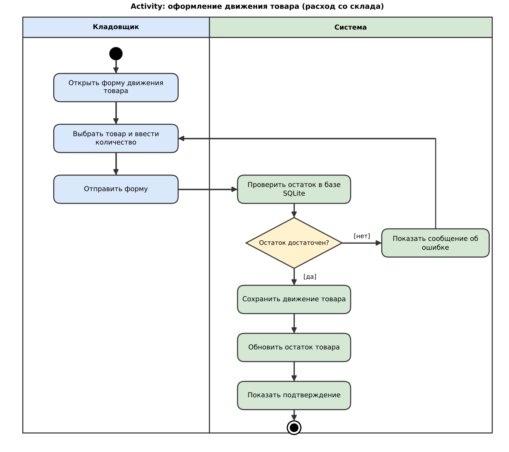
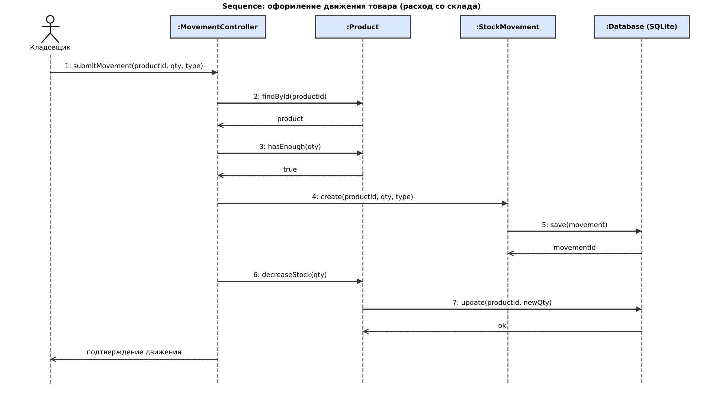

# Development of a Cross-Platform Warehouse System for Intelligent Analysis and Control of Inventory Movement

Автор: [Жанғазы Жәнібек], [ВТиПОук25-5]

## Мәселе
Складтар мен дүкендерде тауар қалдықтары мен қозғалысын бақылау кезінде деректерді қолмен салыстыру уақыт алады және қателіктерге әкеледі. Жүйе тауар есебін, қалдықтарды көрсетуді және еркін сұрақтарға жауап беретін ИИ-чат-бот арқылы жедел талдауды біріктіреді.

## Акторлар
* Қойма / дүкен қызметкері (менеджер)
* Жүйе әкімшісі

## Талаптар
### Функционалдық
1. Жүйе тауар қалдықтарын және кіріс/шығыс қозғалысын SQLite базасында сақтап, көрсетуі керек.
2. Жүйе пайдаланушының еркін сұрақтарына деректер негізінде жауап беретін ИИ-чат-ботты ұсынуы керек.

### Функционалдық емес
1. Жүйе веб-интерфейс арқылы қолжетімді болып, сұраныстарды жылдам өңдеуі керек.

## Диаграммалар
### 1. Use Case

### 2. Class

### 3. Activity: ИИ-чат-бот арқылы тауар қалдығы мен қозғалысын сұрау

### 4. Sequence: ИИ-чат-бот арқылы тауар қалдығы мен қозғалысын сұрау

